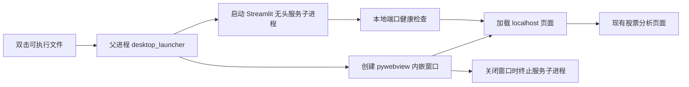

## User Requirements
- 将当前可执行文件从“启动系统浏览器访问 Streamlit”改为“打开独立桌面窗口展示应用”。
- 窗口关闭时同步结束后台服务，避免残留进程。
- 页面内容和交互完全保持不变：股票代码/日期/模型控件、指标卡、多周期标签表、K线和均线交互图全部保留。
- 继续支持 macOS 和 Windows 打包分发；macOS 双击 `.app`、Windows 运行 `.exe` 后均应直接进入内嵌窗口。

## Product Overview
应用仍使用现有股票分析页面，但启动方式由外部浏览器改为本地桌面窗口。用户感知上是一个普通桌面软件：打开即见窗口，关闭即退出，不需要手动切换浏览器。

## Core Features
- 可执行文件启动后直接打开桌面应用窗口
- 后台静默启动现有页面服务，不弹出系统浏览器
- 启动时自动选择可用端口，端口冲突不再导致闪退
- 窗口关闭时自动终止后台服务
- 保留现有全部控件、表格、指标、交互图表和缓存逻辑
- Windows 环境缺少桌面 WebView 运行组件时提供明确提示


## Tech Stack Selection
- 沿用现有 Python 3.11、Streamlit、AkShare、pandas、numpy、scikit-learn、plotly、PyInstaller
- 新增 pywebview 作为本地桌面窗口容器，macOS 使用系统 WebKit，Windows 使用 Edge WebView2 Runtime
- 测试继续使用 pytest，测试中不真实启动 GUI 或网络服务
- 不修改 `AkShareDemo.py` 的页面结构和业务逻辑

## Implementation Approach
采用“父进程管理窗口、子进程运行无头页面服务”的方案：父进程选择端口并启动 Streamlit headless 子进程，等待本地健康检查通过后，用 pywebview 创建桌面窗口加载该地址；窗口关闭时父进程终止子进程。

关键决策：
- 保持 Streamlit UI 不变，避免重写 PyQt/Tkinter 界面造成大量回归
- 服务必须以 headless 模式启动，才能避免自动打开外部浏览器
- 父子进程分离比在线程中直接调用 Streamlit CLI 更稳定，便于生命周期管理和异常清理
- 复用现有 `find_free_port()` 与 `multiprocessing.freeze_support()`，避免端口冲突和打包后重复启动多个服务
- Windows 使用 WebView2 而非内嵌完整 Chromium，体积更可控；但需在文档中说明系统运行组件要求

性能与可靠性：
- 端口检测为常数级操作；启动阶段健康检查轮询通常 1 秒内完成，设置 30–60 秒超时防止卡死
- 运行时只有两个进程：Streamlit 服务和桌面窗口，开销低
- 所有异常只输出简短错误或窗口提示，不打印完整行情数据
- 子进程必须在窗口正常关闭、启动失败、超时三种路径下都被清理

## Implementation Notes
- `desktop_launcher.py` 增加模式判断：服务端模式运行 Streamlit CLI；窗口模式启动服务端子进程并打开 pywebview
- Streamlit 参数改为 `--server.headless true`，并保留 `--global.developmentMode false`、`--browser.gatherUsageStats false`
- 健康检查优先使用 `http://localhost:端口/_stcore/health`
- `build_mac.sh`、`build_windows.bat`、`.github/workflows/build-windows.yml` 均需新增 pywebview 收集参数
- 现有 `--collect-all streamlit/numpy/scipy/pandas/akshare/plotly/sklearn/backports` 必须保留，这些参数是此前修复打包运行错误后验证有效的
- PyInstaller 需新增 `--collect-all webview`；Windows 脚本按需补充 WebView 后端相关隐藏导入
- Windows 缺少 WebView2 Runtime 时不回退到浏览器，而是显示明确错误提示和指引
- 不引入日志文件写入，避免新增日志维护成本

## Architecture Design


## Directory Structure
```text
/Users/xuyunxia/ai/GP/
├── desktop_launcher.py
│   # [MODIFY] 拆分为服务端模式和窗口模式。服务端模式运行 Streamlit headless；窗口模式选择端口、启动子进程、等待健康检查、打开 pywebview，并在退出时清理子进程。
├── requirements-dev.txt
│   # [MODIFY] 增加 pywebview 固定版本依赖，保持现有依赖版本不变。
├── build_mac.sh
│   # [MODIFY] 增加 pywebview 收集参数和必要隐藏导入，保留现有全部 collect-all 参数。
├── build_windows.bat
│   # [MODIFY] 增加 pywebview 与 Windows WebView 后端收集参数，保留现有全部 collect-all 参数。
├── .github/workflows/build-windows.yml
│   # [MODIFY] 同步 Windows PyInstaller 构建参数，确保 CI 产物使用内嵌窗口方案。
├── tests/
│   └── test_desktop_launcher.py
│       # [NEW] 纯逻辑测试：端口检测、服务端参数构造、子进程命令构造、健康检查等待逻辑；不启动真实 GUI。
└── README.md
    # [MODIFY] 说明不再打开外部浏览器、窗口关闭即退出、Windows WebView2 要求及分发方式。
```

## Key Code Structures
```python
def build_streamlit_args(app_path: str, port: str) -> list[str]: ...

def build_server_command(port: str) -> list[str]: ...

def wait_for_server(port: str, timeout_seconds: float = 60.0) -> None: ...

def run_server() -> int: ...

def run_window() -> int: ...
```

